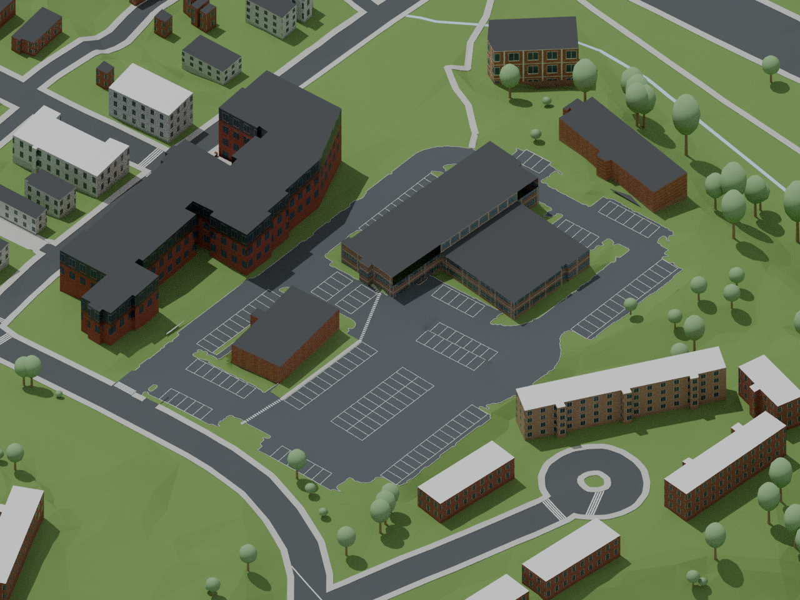
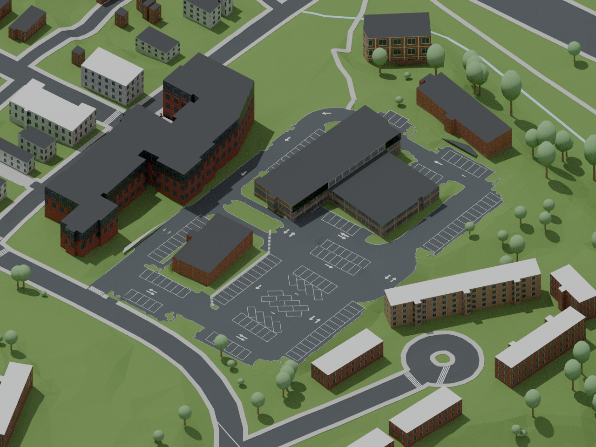

# Monroe — corrected retaining-wall models

Latest corrected downloads, November 18, 2026. These replace the earlier models in `monroe-approved-3d` for Options 1–3.

The retaining wall is at the **7-space-per-side bank between the school and main parking area**. The **top/west side in the original reference is lower**; the opposite/east side is **4 feet higher**. The wall and abrupt step at the other central back-to-back bank have been removed. Each parking configuration stays intact: **142 / 140 / 152 spaces**. The original model is included unchanged from the previous material-repaired export.

## Download

- [FBX models — original + all three corrected options (513 MB)](https://github.com/vintagebyjaja/DrawUp-Claude/raw/refs/heads/migration/personal-masterplan/monroe-corrected-wall/Monroe_4_Models_Corrected_Wall_FBX.zip)
- [Editable Blender models (503 MB)](https://github.com/vintagebyjaja/DrawUp-Claude/raw/refs/heads/migration/personal-masterplan/monroe-corrected-wall/Monroe_4_Models_Corrected_Wall_BLEND.zip)
- [All three view sheets (15 MB)](https://github.com/vintagebyjaja/DrawUp-Claude/raw/refs/heads/migration/personal-masterplan/monroe-corrected-wall/Monroe_Options_1-3_Corrected_Wall_Views.zip)

Separate PDFs: [Option 1](Option_1_Updated_Views.pdf) · [Option 2](Option_2_Updated_Views.pdf) · [Option 3](Option_3_Updated_Views.pdf)

[Vehicle/grade check summary](Vehicle_Check_Summary.pdf) · [Model SHA-256 hashes](SHA256_Models.json) · [Opening instructions and limitations](README.txt)

Import each FBX into a **fresh, separate FormIt document**. All files share site coordinates; importing multiple options together overlaps them. Asphalt/sidewalk colors are embedded as textures. FBXs passed independent Blender reimport, mesh-bound and embedded-texture checks. **FormIt itself was unavailable for direct testing.**

Sampled passenger-vehicle turning and actual-mesh grade screens pass. Routes include slopes around 14% longitudinal and 9.1% cross-slope; this is a concept model assessment, not accessibility or construction certification. Original hill sidewalk/stairs, buildings, public streets and trees are preserved. No car props are included.

## Option 1

[Retaining-wall close-up, viewed from the lower west side](Option_1_Final_Wall_Profile.png) · [Three-page view sheet](Option_1_Updated_Views.pdf)

## Option 2

[Retaining-wall close-up, viewed from the lower west side](Option_2_Final_Wall_Profile.png) · [Three-page view sheet](Option_2_Updated_Views.pdf)

## Option 3

[Retaining-wall close-up, viewed from the lower west side](Option_3_Final_Wall_Profile.png) · [Three-page view sheet](Option_3_Updated_Views.pdf)
